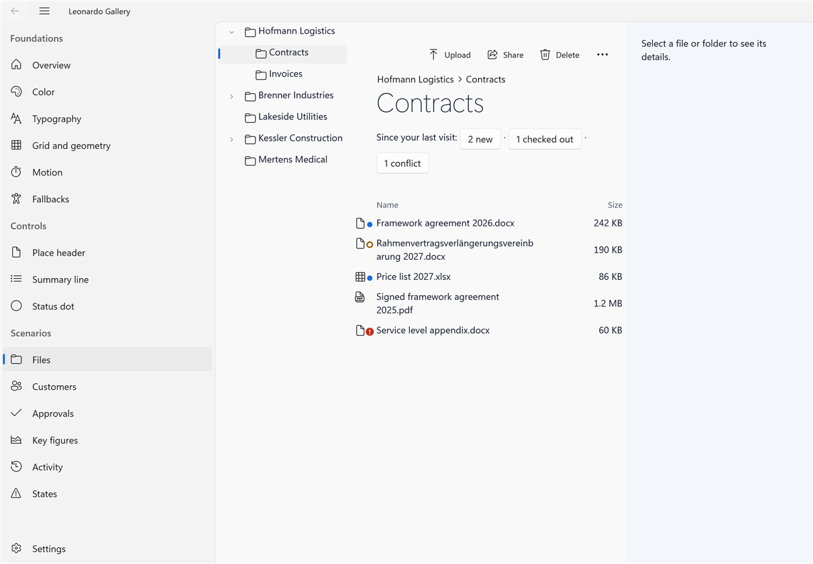
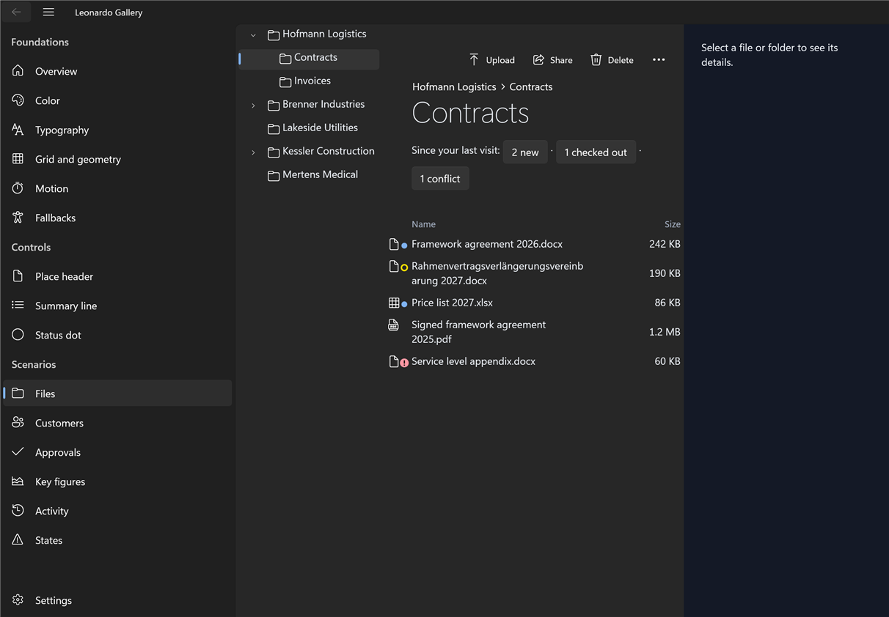
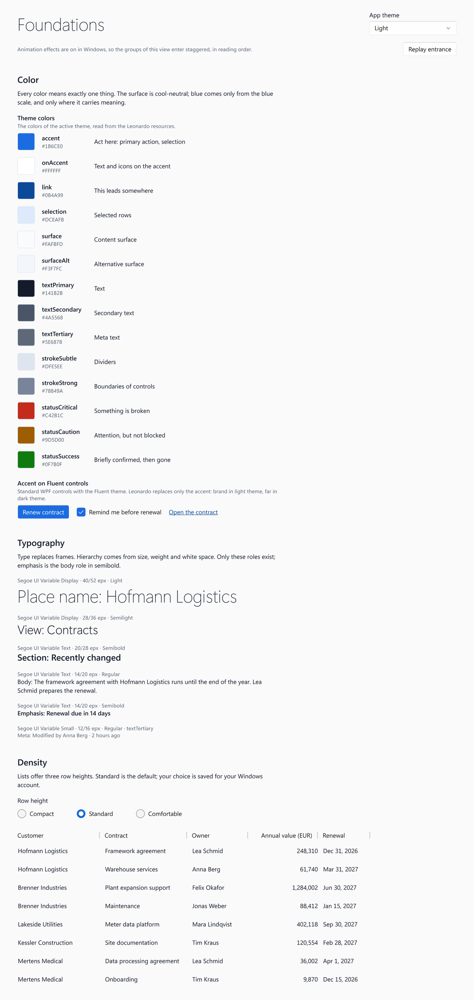
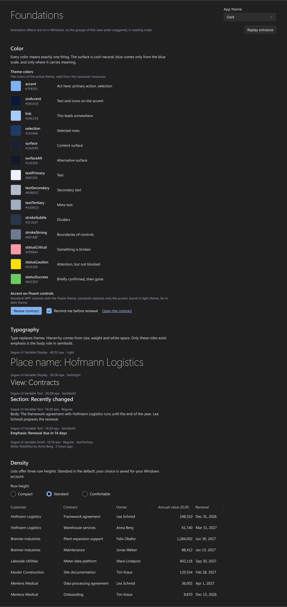
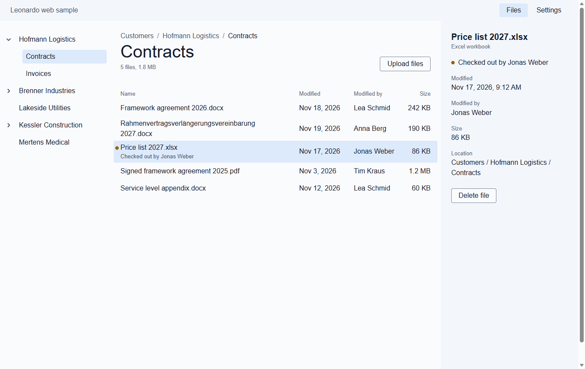
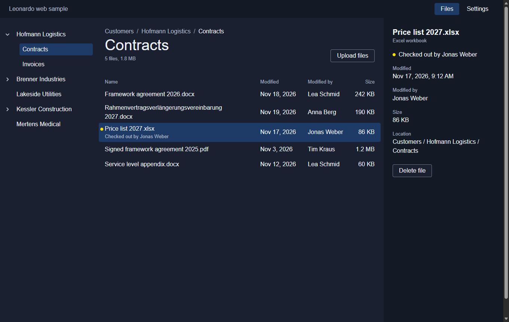

# Leonardo

Leonardo is the design language of up in blue. This repository turns it into tools: design tokens for every platform,
a WinUI 3 library, a WPF resource package, a gallery app, samples for the web and for iOS and macOS, and a Claude Code
plugin with the skill `leonardo`, which designs, revises and reviews the UI of up in blue apps.

Leonardo never replaces the platform. Every app is first a good Windows, iOS, macOS or web app, with good usability.
Leonardo is the up in blue handwriting on top: the blue scale, calm typography as architecture, motion as grammar, and
honest fallbacks for reduced motion, missing transparency and high contrast.

**Status:** version 0.1.1, published on [nuget.org](https://www.nuget.org/profiles/uib). The repository is public under the MIT License; the logos and names are not part of the license (see [License](#license)). See [the changelog](CHANGELOG.md).

## Contents

| Part | Where | For |
| --- | --- | --- |
| Design language | [`docs/design-language.md`](docs/design-language.md), visual version [`docs/leonardo-design-language.pdf`](docs/leonardo-design-language.pdf) | Everyone. The source of truth. |
| Tokens | [`tokens/leonardo.tokens.json`](tokens/leonardo.tokens.json) | Every concrete value |
| `UpInBlue.Leonardo.WinUI` | [`src/UpInBlue.Leonardo.WinUI`](src/UpInBlue.Leonardo.WinUI) | WinUI 3 apps (NuGet package) |
| `UpInBlue.Leonardo.Wpf` | [`src/UpInBlue.Leonardo.Wpf`](src/UpInBlue.Leonardo.Wpf) | WPF apps on .NET 10 (NuGet package) |
| Apple values | [`generated/apple`](generated/apple) | SwiftUI apps on iOS and macOS |
| Web values | [`generated/web/leonardo.css`](generated/web/leonardo.css) | Standalone web apps and websites |
| Presentation values | [`generated/presentation`](generated/presentation) | PowerPoint |
| Gallery | [`samples/UpInBlue.Leonardo.Gallery`](samples/UpInBlue.Leonardo.Gallery) | Every Leonardo resource, motion and control in WinUI 3 |
| Samples | [`samples/`](samples) | A WPF window, a web page and (in stage 6b) a SwiftUI app |
| Claude Code plugin | [`claude/`](claude) | Designing and reviewing UI with Claude Code |
| `UpInBlue.Leonardo.Check` | [`src/UpInBlue.Leonardo.Check`](src/UpInBlue.Leonardo.Check) | `leonardo-check`, a .NET tool that finds literal design values and common accessibility mistakes |

## Screenshots

The WinUI 3 gallery, Files scenario, with `PlaceHeader`, `SummaryLine` and `StatusDot`:

| Light | Dark |
| --- | --- |
|  |  |

The WPF sample on the WPF Fluent theme:

| Light | Dark |
| --- | --- |
|  |  |

The web sample, Files scenario:

| Light | Dark |
| --- | --- |
|  |  |

More screenshots, including every gallery page, are in [`docs/screenshots`](docs/screenshots), one folder per stage.

## Installation

### NuGet packages (WinUI 3 and WPF)

The packages are on nuget.org. WinUI apps target `net10.0-windows10.0.26100.0` or later; WPF apps target
`net10.0-windows`.

```powershell
dotnet add package UpInBlue.Leonardo.WinUI
```

```powershell
dotnet add package UpInBlue.Leonardo.Wpf
```

### SwiftUI and the web

There is no package for these platforms. Copy the generated files from this repository into your project and never edit
the copies; when the tokens change, copy them again.

- SwiftUI: `generated/apple/Leonardo.xcassets` and `generated/apple/LeonardoTokens.swift`
- Web: `generated/web/leonardo.css`

### Claude Code plugin

The plugin with the skill `leonardo` is installed from the marketplace `upinblue` as described in
[`claude/README.md`](claude/README.md).

### Check tool

`leonardo-check` is a .NET tool on nuget.org:

```powershell
dotnet tool install --global UpInBlue.Leonardo.Check
```

Then run `leonardo-check src samples`. The Claude Code plugin runs it after every edit of a UI file; without the tool,
the plugin's hook prints a one-line warning and does nothing else. On Windows the hook runs in Git Bash, which comes
with Git for Windows.

## Quick starts

Every quick start follows the same rules: system typeface on native platforms, Inter on the web, no literal design
values, and the platform's own controls. The design language says why.

### WinUI 3

Merge the Leonardo dictionary after `XamlControlsResources` in `App.xaml`:

```xml
<Application.Resources>
    <ResourceDictionary>
        <ResourceDictionary.MergedDictionaries>
            <XamlControlsResources xmlns="using:Microsoft.UI.Xaml.Controls" />
            <ResourceDictionary Source="ms-appx:///UpInBlue.Leonardo.WinUI/Themes/Leonardo.xaml" />
        </ResourceDictionary.MergedDictionaries>
    </ResourceDictionary>
</Application.Resources>
```

Give the window the Mica backdrop and call `MotionSettings.Initialize()` once on the UI thread. Then use the resources,
the text styles and the controls:

```xml
<Page xmlns:leonardo="using:UpInBlue.Leonardo.WinUI.Controls">
    <Grid RowSpacing="{StaticResource LeonardoSpaceXL}">
        <Grid.RowDefinitions>
            <RowDefinition Height="Auto" />
            <RowDefinition Height="*" />
        </Grid.RowDefinitions>
        <leonardo:PlaceHeader
            Margin="{StaticResource LeonardoSpaceXLHorizontalThickness}"
            Meta="Hofmann Logistics"
            ScrollSource="{x:Bind FileList}"
            Title="Contracts" />
        <ListView x:Name="FileList" Grid.Row="1" />
    </Grid>
</Page>
```

More: [the package README](src/UpInBlue.Leonardo.WinUI/README.md), [the motion helpers](src/UpInBlue.Leonardo.WinUI/Motion/README.md),
[the controls](src/UpInBlue.Leonardo.WinUI/Controls/README.md) and the gallery app.

### WPF

Leonardo builds on the WPF Fluent theme. Suppress the experimental warning for `ThemeMode` (`WPF0001`) in the app's
project file and apply Leonardo at startup:

```csharp
protected override void OnStartup(StartupEventArgs e)
{
    base.OnStartup(e);
    LeonardoTheme.Apply(this, ThemeMode.System);
    new MainWindow().Show();
}
```

`LeonardoTheme.Apply` sets `ThemeMode`, merges the Leonardo dictionary for light, dark or a contrast theme, and follows
Windows while the app runs. Then use the resources:

```xml
<TextBlock
    AutomationProperties.HeadingLevel="Level1"
    Style="{StaticResource LeonardoPlaceNameTextStyle}"
    Text="Contracts" />
```

More: [the package README](src/UpInBlue.Leonardo.Wpf/README.md) and the sample in `samples/UpInBlue.Leonardo.Gallery.Wpf`.

### SwiftUI (iOS and macOS)

Add `Leonardo.xcassets` and `LeonardoTokens.swift` from `generated/apple` to the app target. The namespace enum
`Leonardo` holds colors, spacing, radii, densities, spring parameters and the type roles as system text styles, so
Dynamic Type keeps working:

```swift
import SwiftUI

struct FileRow: View {
    let name: String
    let customer: String

    var body: some View {
        VStack(alignment: .leading, spacing: Leonardo.Space.xs) {
            Text(name)
                .font(.system(Leonardo.TextStyle.body))
            Text(customer)
                .font(.system(Leonardo.TextStyle.meta))
                .foregroundStyle(Leonardo.Colors.textTertiary)
        }
        .padding(.vertical, Leonardo.Space.s)
    }
}
```

Use the platform's navigation for the place name (`navigationTitle` with large titles on iOS, the window title on
macOS). Motion uses springs without bounce, and none when Reduce Motion is on:

```swift
@Environment(\.accessibilityReduceMotion) private var reduceMotion

withAnimation(reduceMotion ? nil : .spring(duration: Leonardo.Motion.Spring.durationMin,
                                           bounce: Leonardo.Motion.Spring.bounce)) {
    isExpanded.toggle()
}
```

The generated colors are looked up in the main bundle, so add the files to the app target, not to a Swift package
module. There is no Apple sample app yet: it was split off from stage 6 into stage 6b, which runs on a Mac. See
[`generated/apple/README.md`](generated/apple/README.md).

### Web

Link the generated stylesheet and Inter, self-hosted. Then use only `--leonardo-*` custom properties:

```html
<link rel="stylesheet" href="leonardo.css">
```

```css
body {
    background: var(--leonardo-surface);
    color: var(--leonardo-text-primary);
    font: var(--leonardo-body-font-weight) var(--leonardo-body-font-size) / var(--leonardo-body-line-height)
        var(--leonardo-body-font-family);
}

h1 {
    font-family: var(--leonardo-place-name-font-family);
    font-size: var(--leonardo-place-name-font-size);
    font-weight: var(--leonardo-place-name-font-weight);
    line-height: var(--leonardo-place-name-line-height);
    margin-block-end: var(--leonardo-space-xl);
}

.panel {
    transition: opacity var(--leonardo-duration-normal) var(--leonardo-ease-enter);
}
```

`leonardo.css` follows `prefers-color-scheme`; set `data-theme="light"` or `data-theme="dark"` on `<html>` to choose.
With `prefers-reduced-motion`, it turns every duration into the short crossfade and every distance into 0, so motion
built from the custom properties follows. The web sample in `samples/web` shows the Files scenario with keyboard
support, forced colors and reduced motion.

## Building from source

Requirements: Windows 11, the .NET 10 SDK (see `global.json`).

```powershell
dotnet build UpInBlue.Leonardo.slnx
```

```powershell
dotnet test --solution UpInBlue.Leonardo.slnx
```

```powershell
dotnet run --project src/UpInBlue.Leonardo.Tokens -- check
```

To change a value, edit `tokens/leonardo.tokens.json` and run the generator with `generate`; never edit generated files.
Packing and publishing the NuGet packages and the check tool is described in [`docs/publishing.md`](docs/publishing.md).

## Contributing

See [`CONTRIBUTING.md`](CONTRIBUTING.md).

## License

The code is licensed under the [MIT License](LICENSE). The names "up in blue" and "uib" and the logos in `brand/` are
not covered by it; see [`TRADEMARKS.md`](TRADEMARKS.md).
